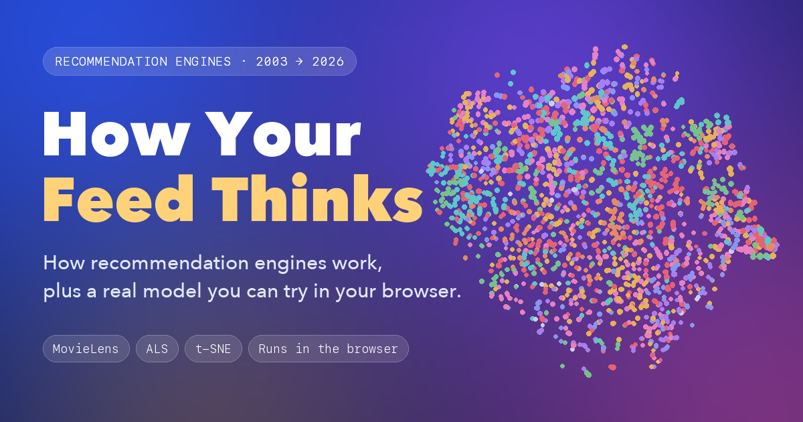

# Next Scroll

**How your feed decides what you see next.** Live: **[luis-moca.github.io/next-scroll](https://luis-moca.github.io/next-scroll/)**



An interactive explainer of recommendation engines, from Netflix Prize-era matrix factorization to today's generative recommenders. Plus a real model you can play with.

## The real part

- Implicit ALS trained on [MovieLens](https://grouplens.org/datasets/movielens/) (81k ratings, 610 people, 2,269 movies).
- Runs 100% in your browser. No server, no API.
- Two modes, measured on 116 people the model never saw:

| | Hit rate (precision@10) | Variety (catalog coverage) |
|---|---|---|
| Accurate | 41.5% | 9.3% |
| Similar | 34.6% | 15.7% |
| Just recommend what's popular | 30.9% | 0.6% |

## Run it

```bash
python3 -m http.server 8000   # then open localhost:8000
```

Retrain (needs numpy and the MovieLens files in `model/raw_data/`):

```bash
python3 model/train.py model/raw_data/ml-latest-small data
```

---

Data: MovieLens ml-latest-small by GroupLens (Harper & Konstan, 2015), non-commercial use. Chapter 2 is opinion, not data.
